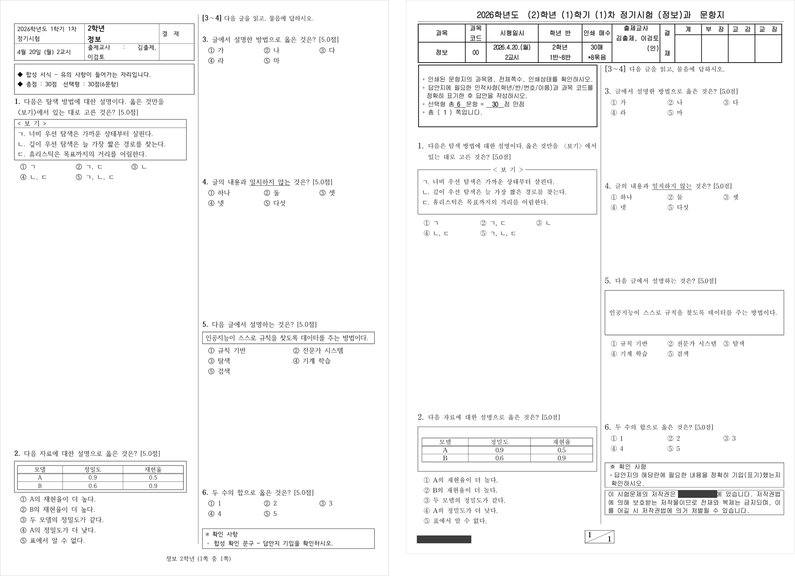

<p align="center">
  <h1 align="center">hwpx-school</h1>
  <p align="center">
    <strong>학교 문서를 마크다운 원고 한 장에서 학교 서식 그대로의 한/글(HWPX) 문서로</strong>
  </p>
  <p align="center">
    <a href="https://github.com/airmang/hwpx-school/blob/main/LICENSE"></a>
    <a href="https://github.com/airmang/python-hwpx"></a>
    <a href="https://github.com/airmang/python-hwpx-automation"></a>
  </p>
  <p align="center">
    <a href="skills/exam/references/문법.md">원고 문법</a>
    · <a href="skills/exam/references/학교-등록.md">학교 등록</a>
    · <a href="exam/README.md">시험지 엔진</a>
  </p>
</p>

시험지(지필평가 원안지), 학습지, 수행평가 문제지, 보고서·계획서를 만듭니다. 원고는 마크다운으로 쓰고, **조판은 우리 학교가
실제로 쓰는 양식 위에 그대로 합니다.** 학교 양식을 한 번 등록해 두면 그 뒤로는 원고만 바꿔 같은 양식의 문서가 나옵니다.
다 만든 뒤에는 실제 한/글로 렌더해 단과 쪽 배치를 확인합니다.
[python-hwpx](https://github.com/airmang/python-hwpx) 7.0(엔진)과
[python-hwpx-automation](https://github.com/airmang/python-hwpx-automation) 8.0(미리보기·렌더·시험지·보고서 조립) 위에서 동작합니다.

<p align="center">
  
</p>
<p align="center"><sub>같은 6문항 원고를 저장소의 합성 서식(왼쪽)과 실제 한 학교의 원안지 양식(오른쪽, 학교 이름은 가림)에 조판하고 한컴오피스 12.30.0으로 렌더한 문항지.</sub></p>

## 만드는 문서

| 문서 | 폴더 | 할 수 있는 것 |
|---|---|---|
| 지필평가 원안지 | `exam/` | 학교 서식 그대로 문항지와 답 표시본(정답 형광펜) 두 판. 〈보기〉·〈조건〉·자료 상자, 표, 그림, 코드, 인라인 수식(`$LaTeX$`), 세트 문항, 짝짓기 답항표. 렌더로 단·쪽 배치를 굳히고 [기계] 검사 보고서를 씁니다 |
| 학습지 | `worksheet/` | hwpx와 docx. 머리띠, 확인 도장, 블록 10종 |
| 수행평가 문제지 | `assessment/` | 학생용과 정답용(정답은 메모) 두 파일 |
| 보고서·계획서 | `report/` | 장 제목 띠(색 칠한 번호 칸), 제목표, □ㅇ-※ 위계를 견본 서식 그대로. 자기 학교·교육청 문서로 견본을 만들면 그 서식으로 나옵니다 |

## 시작하기

Python 3.13과 [uv](https://docs.astral.sh/uv/)가 필요합니다. 배치 확인(렌더)에는 한컴오피스 한글(Windows 또는 macOS)이 필요합니다.

```bash
git clone https://github.com/airmang/hwpx-school
cd hwpx-school/exam
uv run pytest -q -m "not render"     # 한글 없이 — 합성 서식·합성 킷으로 엔진 확인
uv run python -W ignore -m exam_kit.build tests/fixtures/합성서식_6문항.md \
    --kit kits/synthetic --form kits/synthetic/synthetic_form.hwpx --out ~/hwpx-school-예시   # 한글 렌더까지
```

한/글로 이미 만든 원안지(`.hwp`·`.hwpx`)는 원고로 되돌릴 수 있습니다:
`uv run python -m exam_kit.reverse <원안지> --kit <학교 킷> --out <폴더>/원고.md`. 서술형·논술형은 원본 모양 그대로
보존 블록으로 옮겨 심습니다.

학습지와 수행평가는 `worksheet/`·`assessment/`에서 `uv run --python 3.13 pytest -q`로 시작합니다. 폴더마다 독립된
프로젝트입니다.

## 우리 학교 양식으로 쓰기

학교마다 양식이 다르므로, 각자 자기 학교 양식을 **학교 킷**으로 한 번 등록합니다. 그다음부터는 원고와 학교 킷을 함께 주면
그 양식에 맞춰 조판합니다. 학교 양식의 칸·글꼴·간격·안내 문구를 파이썬 코드가 아니라 학교 킷(데이터)이 갖기 때문에,
학교를 새로 더해도 엔진 코드는 바뀌지 않습니다.

| 문서 | 등록할 것 | 그 뒤에 일어나는 일 |
|---|---|---|
| 시험지 | 그 학교의 **빈 원안지 서식** 파일(`.hwp`면 먼저 hwpx로 바꿉니다) | 서식을 해부해 항목별 결정표를 만들고, 확정하면 학교 킷이 됩니다. 문항지·답 표시본은 그 서식 파일 위에 그대로 조판되고, 머리 칸·유의 사항·꼬리 상자도 그 서식의 자리에 채워집니다. 방법: [학교 등록](skills/exam/references/학교-등록.md) |
| 보고서·계획서 | 학교·교육청 문서에 `{{자리표시}}`를 적은 **견본** | 견본의 색·글꼴·장 제목 띠·□ㅇ- 들여쓰기를 그대로 써서 문서를 짓습니다 |
| 학습지·수행평가 | 학교 양식 **원본** 파일 | 원본에서 스켈레톤을 뽑아 학교 킷을 만들고, 그 스켈레톤 위에 조판합니다 |

시험지는 서로 다른 두 학교의 양식(누름틀로 머리 칸을 채우는 양식, 글자 자리를 채우는 양식)으로 등록해 실제 시험지 조판에
써 왔습니다. 학교 킷과 학교 양식 원본은 각자의 PC에만 두고, 이 저장소에는 학교와 무관한 엔진, 범용 스킬, 합성 씨앗 킷과 합성
시험만 들어 있습니다. 맨 위 그림의 오른쪽이 실제 학교 양식으로 등록한 학교 킷의 결과이고, 왼쪽은 저장소의 합성 서식 결과입니다.

## AI 에이전트와 쓰기

Claude Code나 Codex에서 이 저장소를 열고 `skills/`의 `SKILL.md`(exam·worksheet·assessment·report)를 읽게 하면, 에이전트가
원고를 쓰고 조판과 검사를 돌립니다. 원고 문법은 [문법](skills/exam/references/문법.md)에 있습니다.

한/글 문서를 다루는 일반 도구(읽기, 편집, 양식 채우기)까지 함께 쓰려면 python-hwpx-automation의 플러그인을 설치합니다.

```bash
claude plugin marketplace add airmang/python-hwpx-automation && claude plugin install hwpx-plugin@hwpx
codex plugin marketplace add airmang/python-hwpx-automation && codex plugin add hwpx-plugin@hwpx
```

검사 결과는 "기계 잔존 N"일 뿐입니다. 시험지로 내기 전에는 교사가 직접 확인합니다.

## 아직 안 되는 것

- 서술형·논술형 블록을 원고에서 조판하기(지금은 원본 그대로 옮겨 심습니다)
- 가정통신문·공문(기안) 같은 다른 학교 문서
- 보고서 표의 데이터 행 늘리기, 로고 같은 그림이 든 견본 역할

## 라이선스

Apache-2.0 — [LICENSE](LICENSE), [NOTICE](NOTICE)
